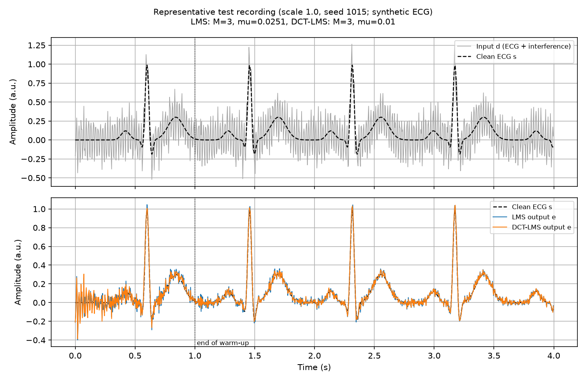
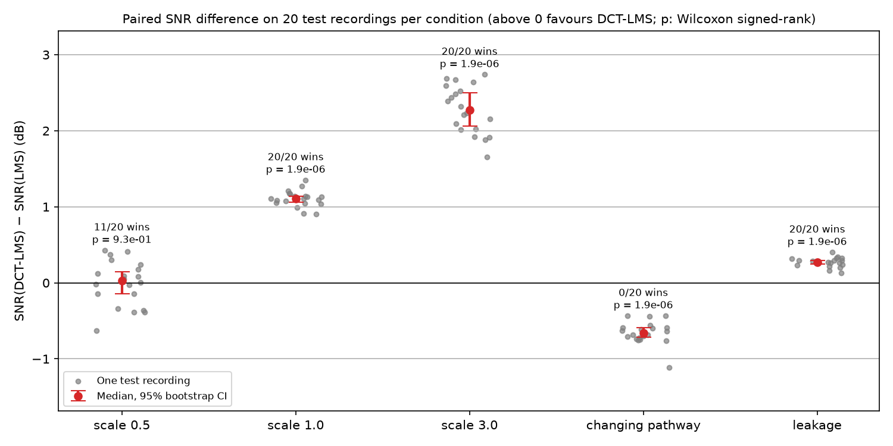
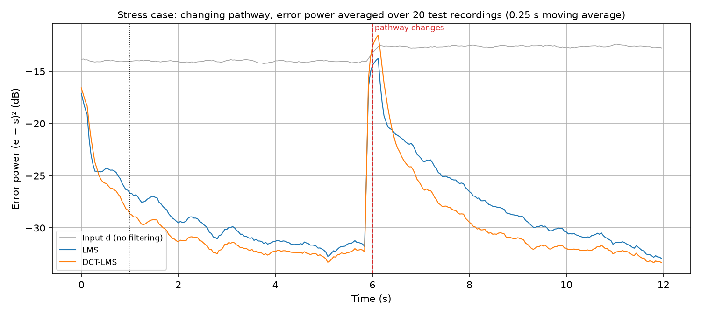
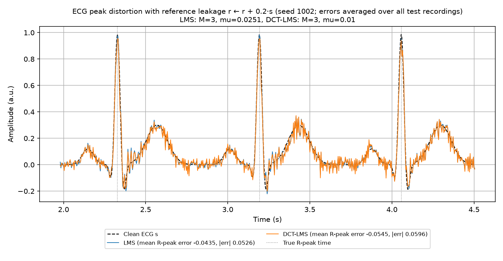

# ECG Adaptive Noise Cancellation: LMS vs DCT-LMS

Course project for EEP55C36 Computational Methods and Algorithms, **Track B
(Biomedical: adaptive ECG noise cancellation)**.

The project reproduces the reference-noise canceller from

> N. V. Thakor and Y.-S. Zhu, "Applications of Adaptive Filtering to ECG
> Analysis: Noise Cancellation and Arrhythmia Detection," *IEEE Transactions
> on Biomedical Engineering*, 38(8), 785–794, 1991.
> https://doi.org/10.1109/10.83591

and compares it with one modification: **transform-domain (DCT) LMS**.
Arrhythmia detection from the paper is out of scope.

All signals are **synthetic ECG-like waveforms**. No clinical claims are made.

## The problem

A measured ECG `d = s + v` is the clean ECG `s` plus interference `v` (here
50 Hz mains hum through an unknown path). A second **reference** input `r`
picks up the interference but not the ECG. An adaptive FIR filter learns to
predict `v` from `r`. The cleaned ECG is the residual `e = d − y`, where `y`
is that prediction.

## Baseline: LMS ([src/ARF.py](src/ARF.py))

Transversal filter with M taps, updated with LMS (paper Eq. 4):

```
x_k     = [r[k], r[k-1], ..., r[k-M+1]]^T    (samples before the start are zero)
y[k]    = w_k^T x_k                          (interference estimate)
e[k]    = d[k] - y[k]                        (cleaned ECG)
w_{k+1} = w_k + 2·mu·e[k]·x_k
```

The factor 2 follows the paper. The course guide writes `w += mu·e·x`, which
is the same update with `mu_guide = 2·mu_paper`. Weights start at zero for
every recording. The cost is O(M) per sample.

`ARF.py` also contains `make_ecg` (the guide's synthetic data generator) and
`snr_db`.

## Modification: DCT-LMS ([src/DCT-LMS_ARF.py](src/DCT-LMS_ARF.py))

The tap vector is rotated into the DCT domain, and every DCT coefficient gets
its own step size, normalised by a running estimate of its power:

```
u_k     = C x_k                              (C: M x M orthonormal DCT-II, built with scipy)
y[k]    = v_k^T u_k
e[k]    = d[k] - y[k]
P_k     = beta·P_{k-1} + (1 - beta)·u_k²     (per-coefficient power, bias-corrected)
v_{k+1} = v_k + 2·mu·e[k]·u_k / (P_k + eps)
```

- **Why it may help.** The reference is a strong 50 Hz sine plus weak white
  noise. Its autocorrelation matrix therefore has a large eigenvalue spread,
  and plain LMS learns the weak (broadband) directions very slowly. The DCT
  roughly decorrelates the taps. Per-coefficient normalisation then evens out
  the convergence speed.
- **Where it may hurt.** Weak coefficients get large steps. The ECG acts as
  noise to the filter, so this can make the adapted weights jumpier,
  especially at large `mu`. The strong 50 Hz direction also adapts more
  slowly than in LMS.
- **Cost.** O(M²) per sample because of the DCT matrix product, against
  O(M) for LMS. At the filter lengths used here, the measured runtime is
  dominated by per-sample Python overhead instead (see Runtime).
- **Ablation.** `normalize=False` switches off only the per-coefficient
  step. Because C is orthonormal, the method then equals `ARF()` exactly (up
  to round-off).
- **The meaning of `mu` differs.** DCT-LMS divides out the reference power,
  so the same `mu` value is a different effective step in each method.
- **Attribution.** S. S. Narayan, A. M. Peterson and M. J. Narasimha,
  "Transform domain LMS algorithm," *IEEE Trans. ASSP*, 31(3), 609–615, 1983.
  F. Beaufays, "Transform-domain adaptive filters: an analytical approach,"
  *IEEE Trans. Signal Processing*, 43(2), 422–431, 1995.

The DCT-LMS file reuses `ARF`, `make_ecg` and `snr_db` from `ARF.py`.

## Repository layout

```
requirements.txt        pinned package versions (pip freeze)
make_figures.py         report figures, built only from the saved results
src/
  ARF.py                baseline LMS, synthetic ECG generator, SNR
  DCT-LMS_ARF.py        modification (DCT-LMS) + LMS vs DCT-LMS demo
tests/
  test_arf.py           pass/fail checks for LMS and DCT-LMS
  test.py               visual test of the baseline on the JSON cases
  compare.py            LMS vs DCT-LMS on the JSON cases (same mu)
  paired_stats.py       main experiment: tuned, paired comparison incl. stress cases
  runtime.py            per-sample runtime benchmark
  test_cases/           test_case_1.json ... test_case_14.json
results/                saved results (CSV/JSON) and figures/ (PNG)
docs/progress.md        dated log of decisions, problems and next steps
```

No paper PDFs are in the repository or its history. `.gitignore` blocks
`*.pdf`, except `report/*.pdf` for the submitted report.

## Setup

Tested on Windows 11 with Python 3.13.7. The exact package versions are
pinned in [requirements.txt](requirements.txt), generated with `pip freeze`
from the tested environment. The direct dependencies are numpy 2.5.4,
matplotlib 3.11.2 and scipy 1.18.1; the rest are their dependencies.

```bash
git clone https://github.com/pablosmgresearch-prog/ECG-Adaptive-Recurrent-Filter.git
cd ECG-Adaptive-Recurrent-Filter
git checkout v1.0-submission      # the assessed version
python -m venv .venv
# Windows PowerShell:  .venv\Scripts\Activate.ps1
# macOS/Linux:         source .venv/bin/activate
python -m pip install -r requirements.txt
```

## Running

Run every command from the repository root, in this order. Times are wall
clock on the tested machine (see Runtime for its CPU).

| # | Command | What it does | Writes | Time |
|---|---|---|---|---|
| 1 | `python tests/test_arf.py` | Pass/fail checks; prints `21/21 passed` | `results/checks.csv` | 4 s |
| 2 | `python tests/paired_stats.py --quick` | Smoke run: 3 validation + 3 test seeds, reduced grid. Checks the installation; its statistics are not meaningful | `results/smoke/*.csv`, `results/smoke/run_info.json` | 14 s |
| 3 | `python make_figures.py --results results/smoke` | Figures from the smoke run | `results/smoke/figures/*.png` | 5 s |
| 4 | `python tests/paired_stats.py` | **Main experiment:** tuning on validation seeds, then the paired comparison on 20 test recordings per condition | `results/paired_results.csv`, `tuning.csv`, `summary.csv`, `learning_curves.csv`, `r_peaks.csv`, `run_info.json` | 228 s |
| 5 | `python make_figures.py` | The four report figures, from the files of step 4; prints the R-peak amplitude errors | `results/figures/*.png` | 5 s |
| 6 | `python tests/runtime.py` | Runtime benchmark at the tuned M and at M = 8, 16 | `results/runtime.csv` | 5 s |
| 7 | `python tests/compare.py` | LMS vs DCT-LMS on the 14 JSON cases at the same `mu`; add `--show` for figures | `results/compare.csv`, `compare_best_worst.csv` | 11 s |
| 8 | `python tests/test.py` | Baseline on the JSON cases; opens one figure per signal | `results/test_cases.csv` | 2 s |
| 9 | `python src/ARF.py` | Baseline demo on seed 0; opens a figure | nothing | 1 s |
| 10 | `python src/DCT-LMS_ARF.py` | LMS vs DCT-LMS demo on seed 0; opens a figure | nothing | 2 s |

- **`--show`.** `paired_stats.py`, `make_figures.py` and `compare.py` only
  open figure windows with `--show`. Steps 8–10 always open windows; close
  them to finish.
- **Output folders.** Every script creates the folders it writes to.
- **Results that can differ between machines.** Step 4 overwrites
  `results/` with identical numbers, because all seeds are fixed. Only
  timing columns (`runtime_ms`, `runtime.csv`, `compare.csv`) change from
  run to run.

## Outputs

All results are in [results/](results/). Figures are generated from the
saved files by `make_figures.py`, never from in-memory numbers.

| File | Written by | Contents |
|---|---|---|
| `paired_results.csv` | `paired_stats.py` | one row per (condition, seed, method): M, mu, input SNR, output SNR, SNR gain, runtime of the call (ms) |
| `tuning.csv` | `paired_stats.py` | every (condition, method, M, mu) tried on the validation recordings, its mean SNR, and which one was selected |
| `summary.csv` | `paired_stats.py` | per condition: tuned settings, median SNRs, median paired difference, 95% bootstrap CI, wins, Wilcoxon p, verdict |
| `learning_curves.csv` | `paired_stats.py` | error power (e − s)² in dB over time, averaged over the 20 test recordings, per condition and method (0.25 s moving average, every 10th sample) |
| `r_peaks.csv` | `paired_stats.py` | output vs clean amplitude at every true R peak after warm-up |
| `run_info.json` | `paired_stats.py` | Python/numpy/scipy/matplotlib versions, OS, CPU, date, git commit, grid, seeds, recording length, fs, warm-up, what the runtime includes |
| `runtime.csv` | `runtime.py` | per-call and per-sample runtime, with CPU and versions |
| `compare.csv`, `compare_best_worst.csv` | `compare.py` | untuned, same-`mu` comparison on the 14 JSON cases |
| `test_cases.csv` | `test.py` | baseline on the JSON cases: 50 Hz attenuation, final weights |
| `checks.csv` | `test_arf.py` | each check and whether it passed |
| `figures/*.png` | `make_figures.py` | the four figures below |
| `smoke/` | `paired_stats.py --quick` | the same files from the smoke run (not committed) |

### Figures

**a. Representative example.** One test recording at scale 1.0: the seed
whose paired difference is closest to the median.



**b. Overall comparison.** Paired SNR difference per condition, with the
median and its 95% bootstrap CI.



**c. Stress case.** Learning curves when the interference pathway changes
at 6 s, averaged over 20 test recordings.



**d. ECG peak distortion with reference leakage.** Zoom on three R peaks,
with the mean R-peak amplitude error over all test recordings in the
legend.



Figures a and d need a full time series, which is not stored, so
`make_figures.py` re-runs both filters on that one recording. It uses the
seed and the tuned (M, mu) read from `paired_results.csv`.

### Checks ([tests/test_arf.py](tests/test_arf.py))

Runs without extra packages (pytest also works if installed). It separates
two questions.

**Is the code correct?**
- The guide's hand-computed example: d=[1,1], r=[1,1], M=1 gives e=[1, 0.5]
  and w=0.75.
- Limiting cases: a zero reference, and `mu=0`, both pass the input through
  unchanged.
- `e + y = d` holds exactly.
- Results agree with an independent transcription of the update.
- Output shapes are right and all values finite.
- Inputs are not modified.
- Bad arguments raise `ValueError`.

**Is the model valid?**
- With a white-noise reference the weights recover the true pathway
  `[0.35, -0.15, 0.08]`.
- On development seeds 0–19 the SNR gain is above 10 dB.
- Far above the stability bound, the filter diverges.

**DCT-LMS checks** (same structure):
- A hand-computed example where the normalisation matters: d=[1,1],
  r=[2,2], M=1, mu=0.25 gives e=[1, 0.5] and w=0.375. Plain LMS would give
  w=0.
- Ablation: with `normalize=False` it equals `ARF()` to 1e-12, for M = 1,
  8 and 16.
- The DCT matrix is orthonormal and matches `scipy.fft.dct`.
- A zero reference, and `mu=0`, pass the input through unchanged.
- Shapes, finite outputs and `e + y = d` hold; inputs are not modified;
  bad `beta` or `eps` values raise `ValueError`.
- It recovers the true pathway with a white-noise reference, and gains
  more than 10 dB SNR on seeds 0–19.

### Test cases ([tests/test_cases/](tests/test_cases/))

Each JSON file sets `seed`, `seconds`, `fs`, `scale` (reference amplitude),
`n_taps`, `mu`, `warmup_s` and `smooth_window_s`. The 14 cases cover three
signals, each with a sweep of fixed `mu` values:

| Signal | seed | scale | M | fs | `mu` values | Files |
|---|---|---|---|---|---|---|
| Baseline | 0 | 1.0 | 8 | 250 Hz | 0.0005, 0.001, 0.005, 0.02, 0.05 | 1, 4–7 |
| Strong interference | 1 | 3.0 | 16 | 250 Hz | 0.0001, 0.0005, 0.001, 0.003, 0.006 | 2, 8–11 |
| Weak interference | 2 | 0.5 | 4 | 500 Hz | 0.0005, 0.002, 0.01, 0.05 | 3, 12–14 |

Cases that differ only in `mu` are plotted together.

### Visual test ([tests/test.py](tests/test.py))

One figure per signal, one curve per `mu`:
- **Time domain:** the output over the first 4 s.
- **Frequency domain:** the spectrum after warm-up, with the 50 Hz
  attenuation in the legend.
- **Learning curve:** smoothed output power in dB.

It uses only what the filter sees (`d`, `r`, `e`), never the clean ECG.

### Comparison ([tests/compare.py](tests/compare.py))

Both methods get the same `d`, `r`, M and `mu`. The script prints:
- one table per signal, with SNR, 50 Hz attenuation, output power and
  runtime (median of 3 runs after a warm-up run);
- a summary of each method's best and worst case, ranked by **SNR gain**
  (output SNR minus input SNR).

Runtime is measured with `timeit`.

Figures, with `--show` only:
- **Per signal:** attenuation against `mu`, and learning curves for both
  methods.
- **Best and worst cases:** a 2×2 grid showing both methods' outputs.

The clean ECG is used only to compute SNR. It is never given to the filters
and never plotted.

SNR follows the course guide: `SNR = 10·log10(Σ s² / Σ (ŝ − s)²)`, computed
after a 1 s warm-up. Higher is better. A small `eps` (1e-12) is added to
both sums so the ratio stays finite for a perfect estimate.

### Paired statistical comparison ([tests/paired_stats.py](tests/paired_stats.py))

This is the main experiment. It follows the course guide's protocol.

1. **Seeds.**
   - Validation seeds 100–109 select the settings.
   - Independent test seeds 1000–1019 are used once, for the final
     comparison.
   - Development seeds 0–19 are not used here.
2. **Tuning.**
   - Each method searches the same grid: M ∈ {1, 2, 3, 4, 8, 16} and 16
     log-spaced `mu` values from 1e-4 to 1e-1
     (`np.geomspace(1e-4, 1e-1, 16)`, about 1.58× apart), so both get an
     equal budget of 96 settings.
   - The setting with the highest mean validation SNR is kept.
   - The script warns if a tuned setting lands on the edge of the grid.
     None does in the current run.
   - **The grid changed twice.** It was first widened, after a run picked
     settings on its edge. It was then refined from a ~3×-spaced `mu` grid
     with 7 values: LMS's best `mu` scales with 1/scale², while DCT-LMS's is
     scale-invariant, so the coarse grid could leave LMS far from its
     optimum. The refinement changed the results; see below.
3. **Conditions.**
   - Reference scales 0.5, 1.0 and 3.0, each tuned on its own validation
     recordings.
   - Two stress cases, using the settings tuned at scale 1.0:
     - **changing pathway:** the interference path switches halfway
       through the recording;
     - **leakage:** ECG leaks into the reference, `r ← r + 0.2·s`.
4. **Metric**, fixed in advance: SNR after warm-up (higher is better).
5. **Statistics** on the paired difference SNR(DCT-LMS) − SNR(LMS), with no
   normality assumption:
   - the median difference, with a 95% percentile-bootstrap CI (10 000
     resamples of whole recordings, fixed seed);
   - the win count;
   - a two-sided Wilcoxon signed-rank test, with a Bonferroni-corrected
     threshold of 0.05 / 5 = 0.01.

   Each recording counts as one independent sample.

## Results

From `python tests/paired_stats.py`, with 20 paired test recordings per
condition:

| Condition | Tuned M, `mu` (LMS / DCT-LMS) | Median input | Median LMS | Median DCT-LMS | Median difference [95% CI] | Wins | Wilcoxon p |
|---|---|---|---|---|---|---|---|
| scale 0.5 | 2, 0.0398 / 3, 0.00631 | 6.24 | 18.53 | 18.93 | **+0.39** [+0.26, +0.57] | 18/20 | 1.7e-4 |
| scale 1.0 | 3, 0.0251 / 3, 0.01 | 0.35 | 17.25 | 18.19 | **+0.99** [+0.95, +1.06] | 20/20 | 1.9e-6 |
| scale 3.0 | 3, 0.00631 / 3, 0.0158 | −9.15 | 14.79 | 17.02 | **+2.24** [+2.12, +2.27] | 20/20 | 1.9e-6 |
| changing pathway | as scale 1.0 | −0.48 | 12.15 | 11.93 | **−0.26** [−0.31, −0.19] | 0/20 | 1.9e-6 |
| leakage | as scale 1.0 | 0.35 | 13.41 | 13.33 | **−0.08** [−0.10, −0.06] | 1/20 | 1.7e-4 |

SNR values are in dB. Wins are recordings where DCT-LMS has the higher SNR.
All five differences are significant at the Bonferroni threshold of 0.01.
1.9e-6 is the smallest p-value the Wilcoxon test can give with 20
recordings, reached when one method wins every recording.

- **DCT-LMS helps more the stronger the interference:** +0.39 dB at scale
  0.5, +0.99 dB at scale 1.0 and +2.24 dB at scale 3.0. Refining the grid
  improved LMS at scale 3.0 by about 1.2 dB (median 13.61 → 14.79 dB), but
  it improved DCT-LMS by about as much, so the scale-3.0 gain barely moved
  (+2.27 → +2.24 dB). At scale 0.5 the finer grid turned "no difference"
  (+0.03 dB, 11/20) into a small but consistent gain for DCT-LMS.
- **It recovers worse when the pathway changes mid-recording.**
  Normalisation slows the dominant 50 Hz direction to the same pace as the
  others, so re-learning it takes longer. With the finer grid the deficit
  is smaller (−0.66 → −0.26 dB) but still on every recording.
- **The leakage result is not robust to tuning.** It has flipped sign with
  each grid change: LMS better, then DCT-LMS (+0.27 dB), and now LMS again
  by a very small margin (−0.08 dB, 1/20). With ECG leaking into the
  reference, the two methods are effectively equal. Read this as "no
  practical difference", not as a win for either method.
- **It is about 3 times slower than LMS** in this implementation. See
  Runtime below.

### ECG peak distortion

`python make_figures.py` prints this from `results/r_peaks.csv`. Each value
is output minus clean at the true R-peak sample, over the 251 R peaks after
warm-up in the 20 test recordings. The clean R amplitude is about 1.

| Condition | LMS mean error | LMS mean abs. error | DCT-LMS mean error | DCT-LMS mean abs. error |
|---|---|---|---|---|
| scale 0.5 | +0.0099 | 0.0221 | +0.0177 | 0.0251 |
| scale 1.0 | +0.0379 | 0.0416 | +0.0283 | 0.0343 |
| scale 3.0 | +0.0895 | 0.0926 | +0.0454 | 0.0505 |
| changing pathway | +0.0384 | 0.0533 | +0.0296 | 0.0451 |
| leakage | −0.0435 | 0.0526 | −0.0545 | 0.0596 |

- **Without leakage, both methods slightly overestimate the R peak.**
  That is residual interference adding to the peak. DCT-LMS's error is
  smaller except at scale 0.5.
- **With leakage the sign flips: both methods shrink the R peak.** This is
  expected, because part of the ECG is now in the reference and the filter
  removes it. DCT-LMS shrinks the peak slightly more (−5.5% vs −4.4% of
  the R amplitude).

### Runtime

From `python tests/runtime.py` (saved in `results/runtime.csv`). Each value
is one filter call on one 12 s recording at 250 Hz (3000 samples, seed 1000,
scale 1.0). It is the median of 7 `timeit` runs after a warm-up call.

- **Excluded:** data generation.
- **Included:** the per-call setup inside the function (input checks,
  allocation, and the DCT matrix for DCT-LMS). Building the DCT matrix on
  its own takes about 0.014 ms, which is negligible.
- **Machine:** Intel64 Family 6 Model 126 Stepping 5, GenuineIntel (AMD64),
  Windows 11.
- **Software:** Python 3.13.7, numpy 2.5.4, scipy 1.18.1.

| Method | M | Median per call (ms) | µs per sample |
|---|---|---|---|
| LMS | 3 (tuned) | 16.82 | 5.61 |
| LMS | 8 | 15.57 | 5.19 |
| LMS | 16 | 14.46 | 4.82 |
| DCT-LMS | 3 (tuned) | 45.45 | 15.15 |
| DCT-LMS | 8 | 48.34 | 16.11 |
| DCT-LMS | 16 | 48.06 | 16.02 |

In theory LMS costs O(M) per sample and DCT-LMS O(M²), because of the DCT
matrix product. At these filter lengths, though, neither cost is visible.
The time is dominated by the Python loop's fixed per-sample overhead, so
runtime hardly changes from M=3 to M=16. DCT-LMS is about 3× slower because
it performs more NumPy operations per sample, not because of the M² term.
Timings vary by a few percent between runs (compare the median and minimum
columns in the CSV).

**Why the normalisation helps.** The reference's autocorrelation matrix has
a large eigenvalue spread: 23 at M=3 and 55 at M=8. LMS's slowest direction
therefore converges very slowly. With DCT plus normalisation the spread
halves at M=3 (to 12.7), but at M=8 it gets worse (69). A 50 Hz tone does not
land on a DCT bin, so the DCT only roughly diagonalises the matrix. The gain
therefore holds for short filters, which is what validation selected, not
in general.

`python tests/compare.py` gives a complementary, untuned view: the same
`mu` for both methods on the 14 JSON cases. There, DCT-LMS degrades sharply
at large `mu`.

## Limitations

- **One recording length and sample rate** (12 s at 250 Hz) in the
  statistical comparison. The 20 test recordings per condition differ in
  heart rate, interference phase and noise, but not in duration.
- **The stress cases reuse settings tuned at scale 1.0.** They test
  robustness to an unexpected change, not best-case performance.
- **ECG peak distortion is measured only at the R peak.** It is the
  amplitude at the true R-peak sample, not peak timing or the shape of the
  P and T waves.
- **The leakage result is sensitive to tuning.** Its sign changed with
  each grid change.
- **The synthetic ECG is a sum of Gaussian pulses,** not a physiological
  model. The interference is a single 50 Hz tone.
- **The method assumes the reference is uncorrelated with the ECG.** If the
  reference contains ECG, the filter will remove part of the ECG too.

## Assistance declaration

Parts of the code and this README were written with the help of an AI
assistant (Claude, Anthropic). This includes the submission preparation on
the `submission-prep` branch:
- saving results and generating figures from them (`make_figures.py`);
- the `--quick` smoke run;
- the refined tuning grid and re-run;
- the runtime benchmark (`tests/runtime.py`);
- `docs/progress.md`;
- removing the paper PDF from the git history and tagging
  `v1.0-submission`.

An AI-written report draft was also made on that branch. It was deleted
and is not part of the submission.
