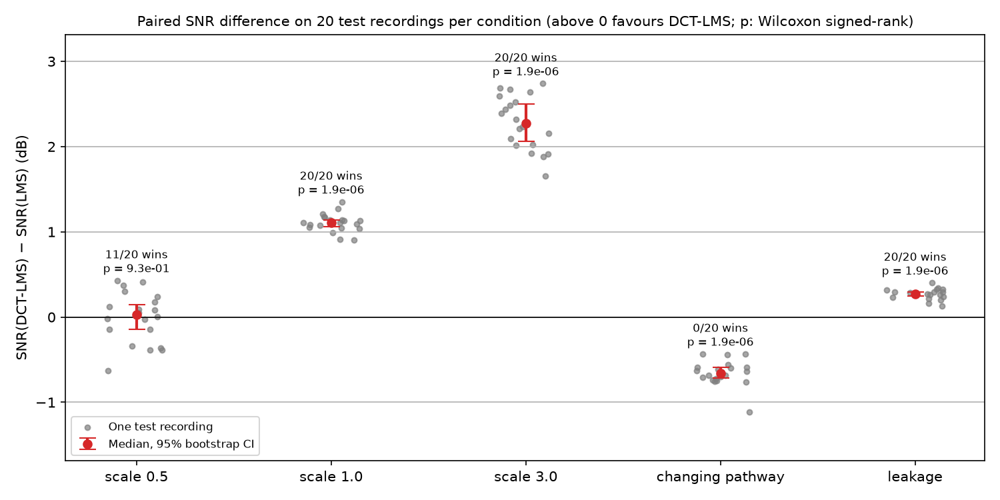
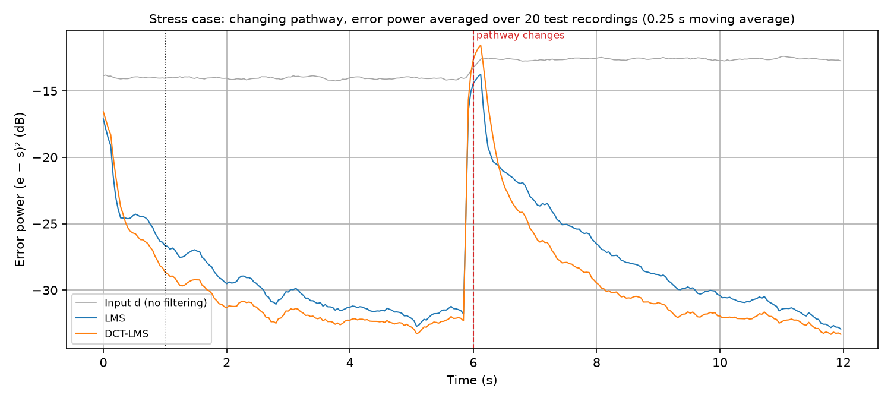
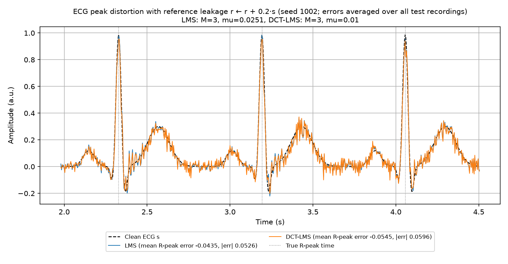

# Adaptive ECG Noise Cancellation: LMS vs Transform-Domain (DCT) LMS

EEP55C36 Computational Methods and Algorithms — Final project, Track B
(Biomedical). Author: *[name]*. Date: *[date]*.

> Draft. Every paragraph marked `<!-- REVIEW -->` was drafted with AI
> assistance and must be rewritten in my own words before submission.
> All numbers come from `results/*.csv`, produced by the commands in
> Section 6.

## 1. Problem and paper

<!-- REVIEW -->
An electrocardiogram (ECG) records the heart's electrical activity, but
measurements pick up interference such as 50 Hz mains hum. Thakor and Zhu
(1991) proposed reference-noise cancellation for this problem. A second
input, the reference, records the interference but not the ECG. An
adaptive filter learns to predict the interference from the reference and
subtracts it. This project reproduces only that noise-cancellation part
(the least-mean-squares (LMS) canceller). The paper's arrhythmia detection
is out of scope.

<!-- REVIEW -->
All data are synthetic. The course guide's generator builds an ECG-like
waveform from five Gaussian pulses per beat (P, QRS, T). The reference is a
50 Hz sine plus 20% white noise, scaled by a factor *scale*. The
interference is the reference passed through an unknown 3-tap pathway
[0.35, −0.15, 0.08], and small measurement noise is added. The method
assumes that the ECG is uncorrelated with the reference. The leakage
stress case (Section 4) deliberately breaks this assumption. No clinical
claims are made.

## 2. Mathematics and implementation

<!-- REVIEW -->
At sample *k* the measured signal is *d*[k] = *s*[k] + *v*[k]: clean ECG
plus interference. The tap vector **x**_k = [r[k], …, r[k−M+1]]ᵀ holds the
current and the previous M−1 reference samples, which are zero before the
recording starts. The filter predicts the interference as
*y*[k] = **w**_kᵀ**x**_k. The cleaned ECG is the residual
*e*[k] = *d*[k] − *y*[k]. LMS minimises J(**w**) = ½E[(d − **w**ᵀ**x**)²].
If *s* is uncorrelated with **x**, minimising J also minimises the remaining
interference. The stochastic-gradient update is
**w**_{k+1} = **w**_k + 2μ e[k] **x**_k, starting from **w**_0 = 0. The
factor 2 follows the paper; the course guide's μ equals 2μ_paper. The
residual is computed before the update. The cost is O(M) per sample
(`src/ARF.py`).

<!-- REVIEW -->
Verification is in `tests/test_arf.py`, with 21 checks, all passing
(`results/checks.csv`). Code-correctness checks:
- the guide's hand-computed example (d = r = [1, 1], M = 1 gives
  e = [1, 0.5] and w = 0.75);
- limiting cases: a zero reference or μ = 0 leave the input unchanged;
- the identity e + y = d;
- agreement with an independent transcription of the update;
- finite outputs, correct shapes, inputs not modified, and invalid
  arguments raising errors.

Model-validity checks are kept separate. With a white-noise reference the
weights recover the true pathway. SNR improves by more than 10 dB on
development seeds 0–19. Far above the stability bound the filter diverges.

## 3. The change: DCT-LMS

<!-- REVIEW -->
The change is transform-domain LMS (Narayan, Peterson & Narasimha, 1983;
Beaufays, 1995), implemented independently in `src/DCT-LMS_ARF.py`. The tap
vector is rotated by the orthonormal M×M DCT-II matrix C:
**u**_k = C**x**_k. Each coefficient's power is tracked with
P_i ← βP_i + (1−β)u_i², with β = 0.99 and bias correction. The update
becomes v_i ← v_i + 2μ e u_i / (P_i + ε), with ε = 10⁻⁸. Only the step
size differs from LMS. With `normalize=False`, DCT-LMS equals LMS to
10⁻¹², because C is orthonormal; this is the ablation.

<!-- REVIEW -->
**Hypothesis.** LMS converges along each eigenvector of the reference's
autocorrelation matrix R at a rate proportional to its eigenvalue λ_i, and
μ is limited by λ_max. A strong sine plus weak noise gives a large
eigenvalue spread: 23 at M = 3 and 55 at M = 8. The weak, broadband
directions therefore learn slowly. If the DCT approximately diagonalises
R, dividing by P_i ≈ λ_i equalises the learning speeds.
- **Expected to help:** strong interference.
- **Expected to hurt:** tracking a sudden change in the dominant direction,
  and amplifying the ECG (which acts as noise) in weak bins.
- **Cost:** O(M²) per sample.

The equalisation is only partial. With normalisation the spread halves at
M = 3 (to 12.7) but grows at M = 8 (to 69), because a 50 Hz tone does not
fall on a DCT bin.

## 4. Experiments

<!-- REVIEW -->
**Data split.** Data are split by whole recordings (12 s at 250 Hz, 3000
samples):
- development seeds 0–19, used while writing the code;
- validation seeds 100–109, used for tuning;
- test seeds 1000–1019, used once.

**Tuning.** Each method chooses (M, μ) separately on the validation
recordings, maximising mean SNR over the same grid: M ∈ {1, 2, 3, 4, 8, 16}
and 16 log-spaced μ ∈ [10⁻⁴, 10⁻¹], an equal budget of 96 settings each.
The grid was refined from a 7-value μ grid during development, because
LMS's best μ scales with 1/scale² and a coarse grid could disadvantage it.
No selected setting lies on the grid edge.

<!-- REVIEW -->
**Conditions** (five, each with the same 20 test recordings for both
methods):
- reference scale 0.5, 1.0 and 3.0, each tuned on its own validation data;
- two stress cases using the scale-1.0 settings:
  - a pathway change at 6 s;
  - leakage of ECG into the reference, r ← r + 0.2s.

**Metric**, fixed in advance: SNR = 10 log₁₀(Σs² / Σ(e − s)²) after a 1 s
warm-up. Higher is better. The clean ECG is used only to evaluate.

**Statistics.** For each condition, the paired difference
SNR(DCT-LMS) − SNR(LMS) per recording, reported as:
- the median, with a 95% percentile-bootstrap CI (10 000 resamples of whole
  recordings);
- the win count;
- a two-sided Wilcoxon signed-rank test, with a Bonferroni threshold of
  0.05/5 = 0.01.

**Runtime** is measured with `timeit` (median of 7 runs after a warm-up),
excluding data generation.

## 5. Results and interpretation

Table 1 — Paired comparison on 20 test recordings per condition
(`results/summary.csv`). SNR in dB.

| Condition | M, μ (LMS / DCT-LMS) | Median LMS | Median DCT-LMS | Median diff. [95% CI] | Wins | p |
|---|---|---|---|---|---|---|
| scale 0.5 | 2, 0.0398 / 3, 0.00631 | 18.53 | 18.93 | +0.39 [+0.26, +0.57] | 18/20 | 1.7e-4 |
| scale 1.0 | 3, 0.0251 / 3, 0.01 | 17.25 | 18.19 | +0.99 [+0.95, +1.06] | 20/20 | 1.9e-6 |
| scale 3.0 | 3, 0.00631 / 3, 0.0158 | 14.79 | 17.02 | +2.24 [+2.12, +2.27] | 20/20 | 1.9e-6 |
| changing pathway | as scale 1.0 | 12.15 | 11.93 | −0.26 [−0.31, −0.19] | 0/20 | 1.9e-6 |
| leakage | as scale 1.0 | 13.41 | 13.33 | −0.08 [−0.10, −0.06] | 1/20 | 1.7e-4 |



*Figure 1 — Paired SNR difference per condition (`make_figures.py`, figure
b).*

<!-- REVIEW -->
DCT-LMS improves SNR in all three scale conditions, and the gain grows with
the interference strength: +0.39, +0.99 and +2.24 dB. This supports the
hypothesis. The change also has two failure cases:
- **Changing pathway:** LMS is better on every recording (−0.26 dB).
  Figure 2 shows why. DCT-LMS has the lower error almost everywhere, except
  for a short, taller error burst right after the change. That burst is
  consistent with normalisation slowing the dominant direction. SNR is an
  energy ratio, so this brief burst outweighs DCT-LMS's lower error over
  the rest of the recording.
- **Leakage:** the methods are practically equal (−0.08 dB). This result
  changed sign each time the tuning grid changed, so it is the least
  convincing result and should not be read as a win for either method.

Both methods shrink the R peak under leakage. DCT-LMS shrinks it slightly
more: the mean R-peak error is −0.0545 against −0.0435, with a clean R
amplitude of about 1 (`results/r_peaks.csv`; Figure 3).



*Figure 2 — Error power when the pathway changes at 6 s, averaged over 20
test recordings (figure c).*



*Figure 3 — R-peak distortion with reference leakage (figure d).*

Table 2 — Runtime per sample (`results/runtime.csv`). 3000 samples; Intel64
Family 6 Model 126; Python 3.13.7, numpy 2.5.4; setup inside the call
included, data generation excluded.

| M | LMS (µs/sample) | DCT-LMS (µs/sample) |
|---|---|---|
| 3 (tuned) | 5.61 | 15.15 |
| 8 | 5.19 | 16.11 |
| 16 | 4.82 | 16.02 |

<!-- REVIEW -->
**Computational cost.** DCT-LMS is about 3× slower. At these filter
lengths the cost is dominated by per-sample Python overhead, not by the
theoretical O(M²) term, so runtime hardly changes with M.

**Limitations:**
- one recording length and sample rate;
- a single-tone interference model;
- a synthetic ECG;
- the gain depends on the DCT roughly diagonalising R, which validation
  achieved with M = 3 but which fails at M = 8.

## 6. Reproduction

<!-- REVIEW -->
- **Repository:**
  https://github.com/pablosmgresearch-prog/ECG-Adaptive-Recurrent-Filter
- **Submitted tag:** `v1.0-submission`
- **Commit hash:** *[full hash from `git rev-parse v1.0-submission`]*

Tested on Windows 11 with Python 3.13.7; package versions are pinned in
`requirements.txt`.

```
python -m venv .venv && .venv\Scripts\Activate.ps1
python -m pip install -r requirements.txt
python tests/test_arf.py                 # 21 checks
python tests/paired_stats.py --quick     # smoke run, ~14 s
python tests/paired_stats.py             # main experiment, ~228 s
python make_figures.py                   # figures from results/*.csv
python tests/runtime.py                  # Table 2
```

Tables 1–2 and Figures 1–3 are produced by these commands. Seeds are fixed,
so every number except the timings reproduces exactly.

<!-- REVIEW -->
**Assistance statement.** Parts of the code, the README and the first draft
of this report were written with the help of an AI assistant (Claude,
Anthropic). I reviewed and can explain all of the code and claims, and I
rewrote this report in my own words. *[Adjust to the college policy.]*

## References

- N. V. Thakor and Y.-S. Zhu, "Applications of adaptive filtering to ECG
  analysis: noise cancellation and arrhythmia detection," *IEEE Trans.
  Biomed. Eng.*, 38(8), 785–794, 1991. doi:10.1109/10.83591
- S. S. Narayan, A. M. Peterson and M. J. Narasimha, "Transform domain LMS
  algorithm," *IEEE Trans. ASSP*, 31(3), 609–615, 1983.
- F. Beaufays, "Transform-domain adaptive filters: an analytical approach,"
  *IEEE Trans. Signal Processing*, 43(2), 422–431, 1995.
